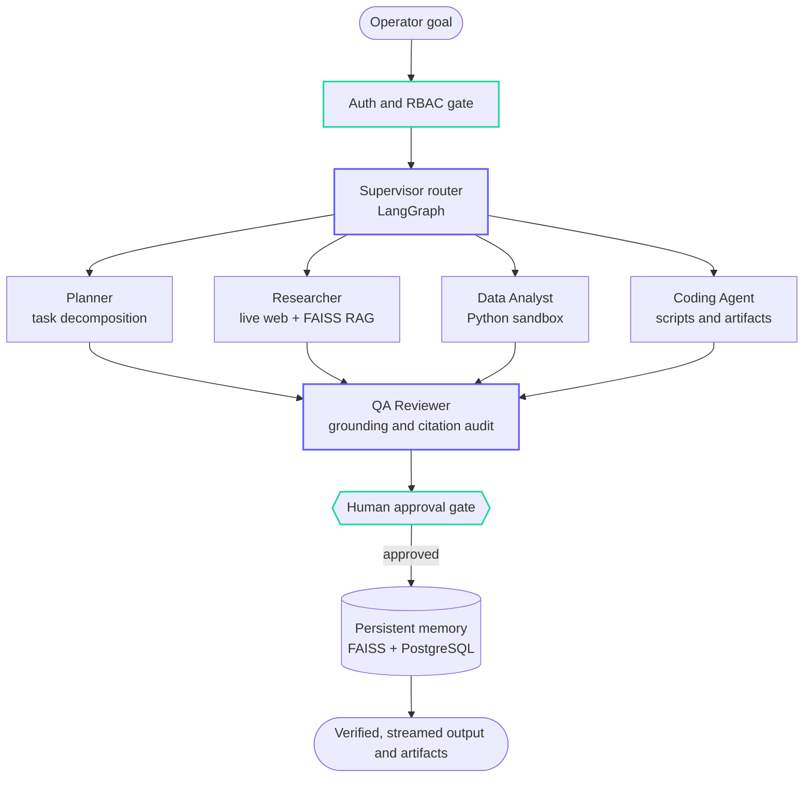

 

 

<table>
  <tr>
    <td align="center" width="140"><h3>8</h3>LangGraph nodes in AZOL AI</td>
    <td align="center" width="140"><h3>98.42%</h3>deepfake detection accuracy</td>
    <td align="center" width="140"><h3>0.9989</h3>ROC-AUC (published)</td>
    <td align="center" width="140"><h3>280+</h3>page software design document</td>
    <td align="center" width="140"><h3>4+</h3>live AI applications</td>
    <td align="center" width="140"><h3>10+</h3>certifications incl. MCP, LangGraph</td>
  </tr>
</table>

 

I am **Md Adil Muzaffar**, an AI/ML engineer focused on agentic AI and GenAI. I build AI systems end to end: agent design, retrieval, backend APIs, frontend, authentication, deployment and documentation. My flagship project, **AZOL AI V1.0**, is a multi-agent platform that I designed, built and deployed solo. I also have a published deepfake-detection framework (my M.Tech thesis) and several deployed LLM applications.

> *"We are moving from training isolated models to deploying autonomous AI systems."*

| | |
|---|---|
| 🎓 **Education** | M.Tech in Computer Science (Data Science), Jamia Hamdard University, New Delhi. CGPA 9.0+/10 |
| 🚀 **Shipped** | AZOL AI V1.0, a live 8-node LangGraph multi-agent platform |
| 📄 **Published** | Interpretable Deepfake Detection Framework: 98.42% accuracy, 0.9989 ROC-AUC |
| 🔭 **Next** | AZOL AI V2.0: autonomous data intelligence (database connectors, NL-to-SQL, live dashboards) |
| 🎯 **Looking for** | AI Engineer · GenAI / LLM Engineer · AI Agent Engineer · Applied ML Engineer |
| 📍 **Based in** | Patna, India. Open to relocation |

 

## ✦ Featured: AZOL AI V1.0

**An autonomous multi-agent AI operating system.** Give it a goal in plain language. It plans, researches, analyzes, executes and verifies the work, then streams back a result you can inspect.

  

**PLAN → RESEARCH → ANALYZE → EXECUTE → VERIFY**

[**Launch the live app**](https://azol-ai.vercel.app) · [**Source code**](https://github.com/mdadilmuzaffar24/AZOL-AI) · [**Portfolio case study**](https://md-adil-muzaffar-portfolia.lovable.app)

<!-- Add your YouTube walkthrough here, for example:
[**Watch the 1080p walkthrough**](https://www.youtube.com/watch?v=YOUR_VIDEO_ID) · -->

> The API may be asleep when idle, so the **first load can take up to a minute** while it wakes up. After that it is fast.

### Why it is different from a chatbot

| | A typical AI chatbot | AZOL AI |
|---|---|---|
| **Scope** | One prompt, one answer | One goal, multi-step execution across specialist agents |
| **Trust** | You fact-check the answer | A QA Reviewer node audits claims against sources before delivery |
| **Risk** | Runs whatever it is asked | Human-in-the-loop approval gate (`interrupt()`) for high-risk steps |
| **Memory** | Forgets between sessions | Persistent project memory (FAISS + PostgreSQL checkpoints) |
| **Isolation** | Flat chat history | Multi-tenant workspaces scoped by user |

### How a goal flows through the system

### What is inside V1.0

| Capability | Details |
|---|---|
| 🧠 **Multi-agent orchestration** | LangGraph supervisor routes work across Planner, Researcher, Data Analyst, Coding and QA Reviewer nodes |
| 📚 **RAG knowledge base** | 5-stage ingestion for PDF, DOCX, PPTX, CSV and TXT. FAISS with `BAAI/bge-small-en-v1.5` embeddings and project-scoped retrieval |
| ⚡ **Live workspace** | React 18 workspace with SSE token streaming, a live React Flow agent graph, and 7 tabs per project (overview, chat, documents, tasks, agents, memory, outputs) |
| 🛡️ **Security** | Google OAuth 2.0, email OTP, HttpOnly JWT cookies, PostgreSQL token-revocation blacklist, rate limiting |
| 📈 **Telemetry** | Execution metrics, token usage and latency views with CSV export |
| ☁️ **Deployment** | Frontend on Vercel, FastAPI on Render, PostgreSQL on Neon. Docker Compose for local infrastructure |
| 📝 **Documentation** | README, 1080p walkthrough video and a 280+ page software design document |

<b>🔭 Roadmap: V2.0 and beyond (planned)</b>

 

**V2.0: From AI workforce to autonomous data intelligence**

- **Database connectors:** read-only access to PostgreSQL, MySQL, MongoDB, Snowflake and CSV/Excel
- **NL-to-SQL and cleaning:** schema introspection, query generation, variance analysis and anomaly detection
- **Live BI dashboards:** interactive dashboards generated from plain-language questions

**Beyond:** an autonomous business OS where agents, data and knowledge work together across a team.

*Everything in this roadmap is planned. V1.0 is what is live today.*

 

 

## 📄 Published Research

**Interpretable Deepfake Detection Framework** · M.Tech thesis, published in CPIJR

Most deepfake detectors give a verdict and nothing else. This one shows *why*. An MTCNN face detector feeds a fine-tuned Xception backbone, and Grad-CAM heatmaps with SHAP attributions highlight the facial regions that drove each decision.

| Accuracy | ROC-AUC | Training data | Tested on |
|:---:|:---:|:---:|:---:|
| **98.42%** | **0.9989** | 10,000+ images from Celeb-DF and DFDC | FaceForensics++ (cross-dataset) |

[Read the paper (DOI)](https://doi.org/10.5281/zenodo.20470289) · [Try the live app](https://universal-deepfake-forensics.streamlit.app) · [Source code](https://github.com/mdadilmuzaffar24/Interpretable-Deepfake-Detection)

 

## 🧪 More Projects

| Project | What it does | Result | Stack |
|---|---|---|---|
| 🧾 [**AI Financial & Ledger Agent**](https://github.com/mdadilmuzaffar24/AI-Ledger-Agent) | Reads vendor invoices from Gmail over OAuth 2.0, extracts Pydantic-validated JSON and posts it to a live Google Sheets ledger. A custom pdfplumber page router keeps long invoices inside the context window | **~80% less manual invoice entry** | LangChain, Llama 3.1 (Groq), Google Workspace APIs, Streamlit |
| 💬 [**AI Document Chatbot (RAG)**](https://github.com/mdadilmuzaffar24/AI-Document-Chatbot) | Question answering over PDF, Word and text files, with Map-Reduce summarisation for documents longer than the model's token limit | Low-latency answers with Llama 3.1 on Groq | LangChain, FAISS, MiniLM, Streamlit |
| 🧬 [**Autism Spectrum Disorder Screening**](https://github.com/mdadilmuzaffar24/Autism_Predicition_ML_project) | Early-screening ML pipeline built during my Edunet × Microsoft internship, using SMOTETomek for class imbalance and threshold tuning | **0.96 CV ROC-AUC**, 0.86 test AUC | XGBoost, scikit-learn, SHAP |
| 📰 [**Fake News Detection**](https://github.com/mdadilmuzaffar24/Fake_News_Prediction) | NLP pipeline with regex cleaning, Porter stemming and TF-IDF, benchmarked across 5 classifiers | **98.4% accuracy**, 0.98 F1 (Linear SVM) | scikit-learn, TF-IDF |

 

## 🛠️ Tech Stack

**Agents & LLMs** 

**Machine Learning & Deep Learning** 

**Backend, Data & Deployment** 

**Frontend** 

 

## 💼 Experience

**Founder & Independent AI Systems Engineer, AZOL AI** · *2026 to present, self-directed* 
Designed, built, deployed and documented a production multi-agent platform end to end: LangGraph orchestration, RAG, security, a React workspace, cloud deployment and a 280+ page design document.

**Artificial Intelligence Intern**, Edunet Foundation (Microsoft, AICTE) · *Apr 2025 to May 2025* 
Built the XGBoost autism-screening model (0.96 CV ROC-AUC) and deployed an image classifier on Azure Custom Vision.

**Data Science Intern**, Internshala Trainings (Remote) · *Jun 2023 to Oct 2023* 
Built a weather-forecast model in Python, analysed IPL ball-by-ball data with SQL for an auction-strategy simulation, and built a Tableau sales dashboard.

 

<b>🎓 Certifications (10+)</b>

 

| Certification | Issuer | Date |
|---|---|---|
| [Agentic AI with LangChain and LangGraph](https://www.coursera.org/verify/FADJ5PHL5L9E) | IBM | Sep 2026 |
| Introduction to Model Context Protocol · MCP: Advanced Topics | Anthropic | Aug 2026 |
| MLOps and Data Pipeline Orchestration for AI Systems | LinkedIn Learning | Jul 2026 |
| Deep Learning Specialization | DeepLearning.AI (Andrew Ng) | Apr 2026 |
| Machine Learning Specialization | Stanford University | Aug 2025 |
| IBM Data Science Professional Certificate | IBM / Coursera | Jun 2025 |
| AI/ML for Crop Acreage Mapping | ISRO IIRS | Apr 2025 |
| Generative AI for Data Science | Microsoft | Mar 2025 |
| Python for Data Analysis and Visualization | Coursera | Mar to Apr 2025 |
| Microsoft Azure AI Essentials Professional Certificate | LinkedIn Learning | |

 

## 🎥 Community

I run the **AI Updates** series on LinkedIn and Instagram, explaining agentic AI and frontier-model research with verified data points to an audience of 1,500+ followers.

 

### Let's build something

I am looking for AI Engineer, GenAI Engineer and AI Agent Engineer roles, and I can join immediately.

[**LinkedIn**](https://www.linkedin.com/in/md-adil-muzaffar) · [**Portfolio**](https://md-adil-muzaffar-portfolia.lovable.app) · [**adilmuzaffar96@gmail.com**](mailto:adilmuzaffar96@gmail.com)

*"I don't just train models. I engineer and ship AI systems to production."*

If AZOL AI or any of these projects is useful to you, a ⭐ on the repo is appreciated.

